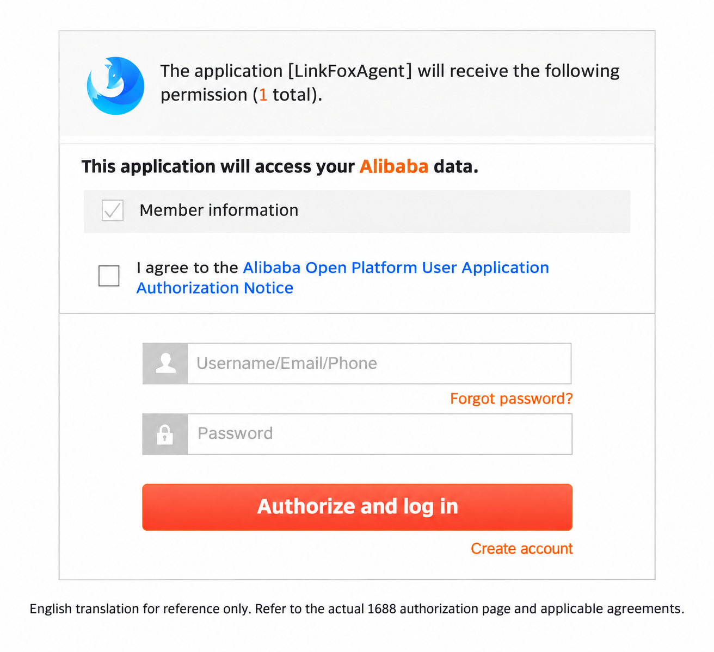

# 1688 Procurement API Reference

## Transport and identity

All operations are POST JSON to `${NEXSCOPE_PROXY_BASE}/api/v1/tools/research/alibaba1688/<operation>`. The base defaults to `https://api.nexscope.ai`; use `Authorization: Bearer <NEXSCOPE_API_KEY>`. One Nexscope key is sufficient for the user. Buyer OAuth on 1688 is still required. Timeout is 150 seconds. No response caching or automatic retries are used. Invoking this Skill consumes credits, including authorization prechecks.

Every operation except `authorizeUrl` and `authorizedStores` is preceded by `authorizedStores`. At least one store must have `status=ACTIVE` and `expired=false`. OAuth token refresh belongs to the backend. Only unavailable authorization requires reauthorization; never display tokens or expiry timestamps.

Complete browser authorization within 10 minutes of requesting the URL. If authorization fails or the link expires, request a new URL, complete OAuth and check `authorizedStores` again. The redirect alone is not proof of authorization. The `authorizedStores` precheck is a separate billable public call in addition to the requested operation; internal token exchange and refresh do not create extra public calls.

Before previewing or placing an order, bind Alipay to the same authorized 1688 buyer account on 1688. OAuth authorization and `authorizedStores` do not verify this payment setup. `BUYER_NOT_BIND_ALIPAY` means the buyer must complete binding on 1688 before another preview; never request Alipay credentials in chat or API parameters.

Authorization is supported by LinkFox Agent, Nexscope's strategic partner in China. You will see "LinkFox Agent" on the 1688 authorization page. Authorize your own 1688 account; Nexscope links it to your Nexscope user account.

The permission descriptions and agreement notice on the 1688 authorization page are in Chinese. Use your browser's translation feature and select English to read them. Changing your browser's language alone does not switch these sections to English.



This translated screenshot is provided for reference only. Please refer to the actual 1688 authorization page and applicable agreements. The translation does not change the official page or indicate that your account is authorized.

Use data only within the scope of your authorization and in accordance with applicable local laws, regulations, and platform terms.

## Operations and request fields

| Operation | Script | Request |
|---|---|---|
| `authorizeUrl` | `authorize_url.py` | Required nonblank string `accountName`, a buyer-account display name |
| `authorizedStores` | `authorized_stores.py` | `{}`; current user's authorized accounts |
| `receiveAddressList` | `receive_address_list.py` | `{}`; current user's addresses |
| `sku` | `sku.py` | Required `offerId`, a positive decimal ID string |
| `orderPreview` | `order_preview.py` | `addressId` or `addressParam`, nonempty `cargoParamList`, `flow`; details below |
| `createOrder` | `create_order.py` | Shared address, cargo and flow inputs plus JSON boolean `confirmCreateOrder: true`; creation options below; does not accept preview-only `invoiceParam` |
| `paymentUrl` | `payment_url.py` | Nonempty string array `orderIdList`; JSON boolean `confirmGetPaymentUrl: true` |
| `orderStatus` | `order_status.py` | Required `aliOrderId` string |
| `logistics` | `logistics.py` | Required `aliOrderId` string |
| `logisticsTrace` | `logistics_trace.py` | Required `aliOrderId`, optional `logisticsId`, both strings |
| `confirmReceive` | `confirm_receive.py` | Required `aliOrderId`; JSON boolean `confirmReceive: true` |
| `cancelOrder` | `cancel_order.py` | Required `aliOrderId`; JSON boolean `confirmCancel: true`; optional `cancelReason`, `remark` |
| `invoiceAmount` | `invoice_amount.py` | Nonempty `orderIds` array of positive decimal ID strings |
| `invoiceApply` | `invoice_apply.py` | Nonempty `invoiceApplyModelList`; JSON boolean `confirmApplyInvoice: true` |

All order/product IDs remain strings to preserve precision. Use the returned `orderId` in the specific request field each operation expects; do not replace `aliOrderId` with `orderId`.

### Preview and creation

- `addressId`: nonempty string from `receiveAddressList`; preferred. Alternatively, `addressParam` contains at least `fullName`, `mobile`, `address` (nonempty strings), optionally `provinceText`, `cityText`, `areaText`, `postCode`, `phone`.
- `cargoParamList`: nonempty array of objects with required `offerId` (positive decimal string), optional `specId` (string), and `quantity` (integer >= 1).
- `flow`: the scripts default it to `general` when omitted; direct API requests must provide it explicitly. Allowed values are `general`, `fenxiao`, `boutiquefenxiao`. Use distribution modes only if explicitly requested; this Skill provides no additional distribution validation.
- `isvBizType`: optional, defaults upstream to `cross`; allowed `cross`, `cross_daigou`, `cross_distribution`.
- Preview may include optional `invoiceParam` with `invoiceType` (integer: 0 ordinary, 1 special VAT), `titleType` (integer: 1 personal, 2 company), and string fields `title`, `taxpayerNumber`, `bankName`, `bankAccount`, `address`, `phone`.
- Creation may also include `message`, `tradeType`, `shopPromotionId`, `outOrderId`, `anonymousBuyer` (JSON boolean), `useRedEnvelope` (`y`/`n`; blank or omitted defaults to `n`), and `fenxiaoChannel` (`douyin`, `kuajing`, `pinduoduo`, `taote`). Supported trade types are `assureTrade`, `alipay`, `period`, `assure`, `creditBuy`, `bank`, `631staged`, `37staged`.
- Both request models accept optional `useBorderLogisticsSolution` (JSON boolean) and `crossBorderLogisticsSolutionId` (string sourceId). As in the original adapter, these logistics options affect order creation; preview does not forward them.
- Each confirmed operation requires a separate explicit confirmation for its exact action. The five confirmation fields are forwarded unchanged. `"true"`, `1` and missing fields are rejected locally.

```json
{
  "flow": "general",
  "addressId": "987654321012345678",
  "cargoParamList": [
    {"offerId": "1234567890123456789", "specId": "456789012345678901", "quantity": 2}
  ]
}
```

### Invoice application

Each `invoiceApplyModelList` entry contains:

| Field | Requirement |
|---|---|
| `orderId` | Positive decimal ID string |
| `amount` | Positive 64-bit integer in **cents**, copied unchanged from `invoiceAmount`; never calculate or convert it |
| `invoiceType` | `VATAX_COMM` (ordinary VAT invoice) or `VATAX_SPEC` (special VAT invoice) |
| `purchaserInvoiceTitleModel` | Object described below |

Title fields:

| Field | Requirement |
|---|---|
| `titleType` | `PERSONAL` or `COMPANY` |
| `title` | Required nonempty invoice-title string |
| `taxpayerIdentify` | Required for `COMPANY` with either invoice type |
| `bankName`, `bankAccountId`, `registerAddress`, `registerPhone` | All required for `COMPANY` + `VATAX_SPEC` |

Use the buyer's confirmed legal title. No invoice-title lookup operation is exposed by this Skill.

```json
{
  "confirmApplyInvoice": true,
  "invoiceApplyModelList": [
    {
      "orderId": "3309156590237728779",
      "amount": 30500,
      "invoiceType": "VATAX_COMM",
      "purchaserInvoiceTitleModel": {"titleType": "PERSONAL", "title": "Example Buyer"}
    }
  ]
}
```

## Response contract

Nexscope responds with `{code, msg, data, traceId, ts, time, cost}`. Only numeric outer `code: 0` is platform success; HTTP 200 alone is insufficient. `cost` is elapsed milliseconds, not credits. Preserve `X-Cost-Token`, `X-Cost-Credit`, `X-Kong-Trace-Id` headers when present.

Scripts unwrap the platform object into business output, retaining platform diagnostics in `_nexscope` and billing headers in `_billing`. They also accept a legacy provider object with `errcode` and optional nested business `data`. Never interpret a deeper business `code` as the Nexscope platform status. Check `success`/`status` as well as platform status; partial invoice lists must remain available on business failure.

| Operation | Business fields and interpretation |
|---|---|
| `authorizeUrl` | `authorizeUrl`: return for manual browser opening |
| `authorizedStores` | `stores[].accountName/status/expired`: current user's authorization; hide token fields and `tokenExpiresAt` |
| `receiveAddressList` | `items[].addressId/fullName/mobile/provinceText/cityText/areaText/address/isDefault` |
| `sku` | `offerId`, `skuList[].specId/skuId/price/amountOnSale/attributes/skuImageUrl`; use `specId` for multi-SKU ordering |
| `orderPreview` | `status`, `message`, `sumPayment`, `sumCarriage`, `discountFee`, `cargoList`, `tradeModelList`, `payChannelInfos`, `shopPromotionList`. Totals in cents; `cargoList.finalUnitPrice/amount` in yuan. `status=false` stops ordering even with platform success; zero totals/empty lines are not evidence of purchasability |
| `createOrder` | `success`, `orderId`, `message`, `code`; retain the ID for reconciliation |
| `paymentUrl` | `success`, `payUrl`, `errorMessage`, `errorCode`; never open or pay automatically |
| `orderStatus` | `aliOrderId`, `aliStatus`, `normalizedStatus` |
| `logistics` | `aliOrderId`, `logisticsOrders[].logisticsId/logisticsBillNo/logisticsCompanyName/status` |
| `logisticsTrace` | `aliOrderId`, `logisticsId`, `traceList[].traceTime/location/traceDescription/traceStatus`; display Asia/Shanghai times |
| `confirmReceive` | `success`, `aliOrderId` |
| `cancelOrder` | `success`, `aliOrderId`, compatibility `orderId`, `message`; cancellation is not refund handling |
| `invoiceAmount` | `success`, `code`, `message`, `subCode/subMessage`, `retCodes[]`, `orderInvoiceAmountModelList[].orderId/amount`; inspect amounts and corresponding return codes per order |
| `invoiceApply` | `success`, `code`, `message`, `subCode/subMessage`, `successList[]`, `failedList[]`; each row may include `orderId/outBizId/result/tradeOrderCompleted/errorCode/errorDesc` |

The procurement response retains a `code/message/data` wrapper inside the Nexscope `data`. Its business result is at `data.data` in the HTTP response. After the script unwraps the Nexscope layer, the result remains inside `data` alongside `_nexscope`. Do not promote supplier codes to Nexscope outer codes. Invoice business failure may arrive with HTTP 200 and business `success=false`: report each order. `INVOICE_ALREADY_APPLIED` in `failedList` means already invoiced. Do not hide partial results or replay an entire batch.

Example platform response for a failed preview:

```json
{"code":0,"msg":"Success","data":{"code":200,"message":"Success","data":{"status":false,"message":"Requested quantity is below the minimum.","sumPayment":0,"cargoList":[]}},"traceId":"example-trace"}
```

Example mixed invoice result:

```json
{
  "code": 0,
  "msg": "Success",
  "data": {
    "code": 200,
    "message": "Success",
    "data": {
    "success": false,
    "successList": [{"orderId": "3309156590237728779", "result": true}],
    "failedList": [{"orderId": "3309156590237728780", "errorCode": "INVOICE_ALREADY_APPLIED", "errorDesc": "Already invoiced"}]
    }
  }
}
```

## Errors and CLI output

Check the HTTP status and Nexscope outer JSON `code` separately; failures can use HTTP 200. Scripts retain the outer fields in `_nexscope` and return `error: nexscope_error` for a nonzero outer code.

| Nexscope outer code | Meaning and recovery |
|---|---|
| `11209` | Missing or nonexistent Nexscope API key; correct authentication |
| `99001` | Invalid parameters, missing boolean confirmation or a service pricing configuration problem; follow the message, correct inputs or contact support |
| `13007` | Buyer authorization is unavailable or a procurement service/proxy call failed; use the message to determine whether reauthorization is needed, without substituting another buyer |
| `13011` | Insufficient Nexscope credits; check the Nexscope balance |
| `99000` | Unexpected service failure; retain trace information and reconcile uncertain writes before retrying |
| `0` with business `status=false` / `success=false` | Platform call completed but the business operation failed or partially failed; inspect nested data and all invoice rows |

The following local/provider conditions are a separate layer. Provider `1002`, `1003` and `1005` are not Nexscope outer error codes. HTTP authentication and credit errors may also be returned by the gateway.

| Condition | Action |
|---|---|
| Missing key / HTTP 401 | Correct Nexscope authentication |
| HTTP 402 | Insufficient credits; use Nexscope account/help |
| `authorization_required` / provider `1005` | Complete buyer OAuth and recheck, without substituting buyer/store |
| `confirmation_required` | Obtain separate confirmation; never coerce string `"true"` |
| `invalid_parameter` / provider `1002` | Correct documented parameters before a paid call |
| Provider `1003`, HTTP 4xx/5xx, network error or invalid JSON | Preserve diagnostic message; reconcile uncertain writes; no automatic replay |
| Business `status=false` or `success=false` | Stop dependent writes and inspect full result, including invoice rows |

CLI exits 2 for local parameter/confirmation failure and 1 for transport or explicit business failure. Results are still printed/saved when available. Neither exit status nor absence of a returned ID proves that an ambiguous write was not executed.

Responses up to 8 KB print sanitized JSON; larger responses save the full sanitized object under `nexscope/<date>/<session>/data/` and print a summary. `--inline`, `--save`, `--no-save`, `--payload-env` and `--payload-file` are supported. Sensitive token/secret fields are redacted, token-expiry metadata omitted; authorized buyer addresses remain available for local selection and must be masked in user-facing output.

```bash
curl -X POST "${NEXSCOPE_PROXY_BASE:-https://api.nexscope.ai}/api/v1/tools/research/alibaba1688/authorizedStores" \
  -H "Authorization: Bearer $NEXSCOPE_API_KEY" \
  -H "Content-Type: application/json" \
  -d '{}'
```
